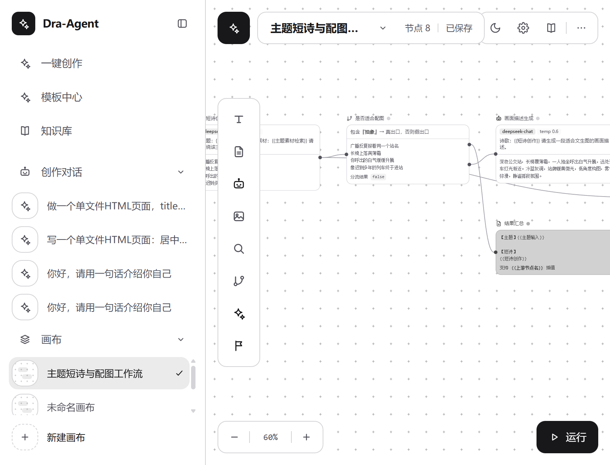
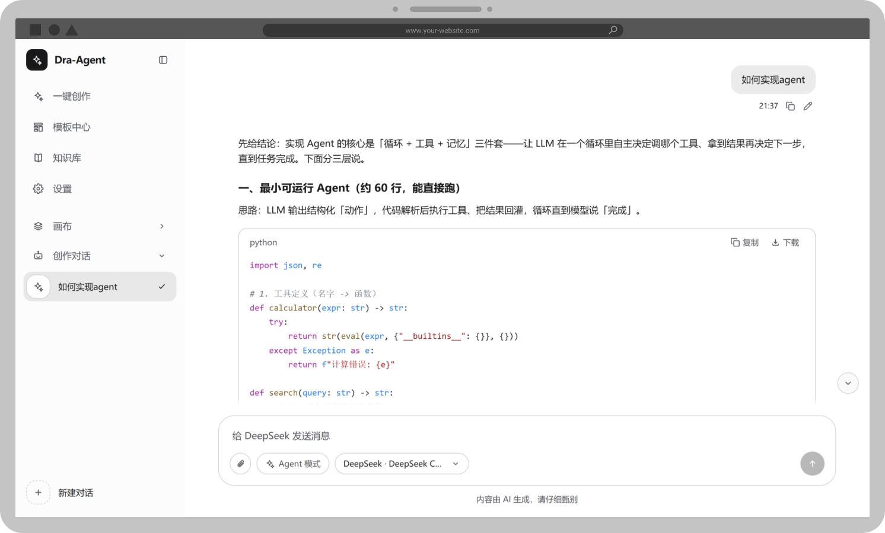
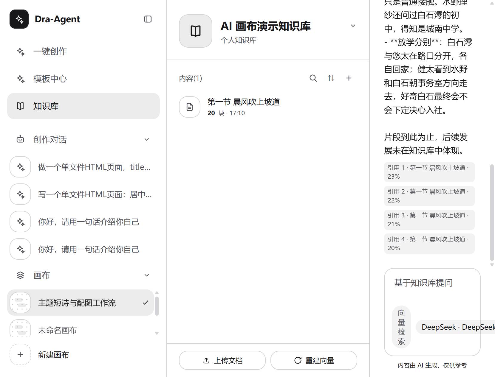
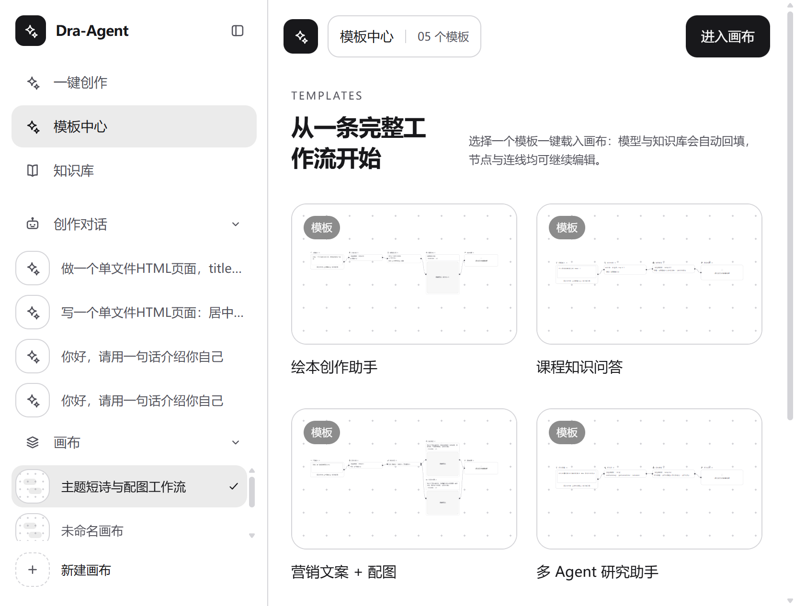

# Dra-Agent

> 可视化 AI Agent 工作流画布 —— 把「编排 AI」「对话 AI」「运行 AI」做成可视、可解释、可沉浸的完整体验。

**Dra-Agent** 是一个开箱即用的 AI 工作流创作平台（React 前端 + Node 服务网关双端 monorepo），提供两条互补的创作路径：

- **画布编排**：拖拽节点、连线，编排「输入 → 大模型 → 知识检索 → 条件分支 → 图像生成 → 输出」工作流；一键运行，数据沿连线流动、节点逐个点亮，AI 的决策路径全程可视。
- **一键创作（对话 Agent）**：服务端驱动的完整对话智能体——多模态输入、RAG 知识检索、ReAct 工具循环、长期记忆、风险分级授权确认；生成的网页代码可就地分栏实时预览。



## 功能特性

### 可视化画布

- **7 类节点**：输入 / LLM / Agent / 图像生成 / 知识检索 / 条件分支 / 输出，拖拽即建、连线即通
- **运行引擎**：拓扑排序调度、连线流动动画、节点状态点亮；条件分支未触发的路径逐边显示警戒标记（逐边级联算法，保护多父汇聚节点）
- **画布管理**：多画布创建 / 切换 / 缩略图，自动保存（localStorage 持久化）；成环检测、剪刀光标剪线、节点聚焦模式

### 对话 Agent（一键创作）

- **ReAct 循环**：服务端多轮「思考 → 调用工具 → 观察结果」循环，过程条实时展示
- **工具风险分级**：工具标注「只读 / 写入 / 高危」三级——只读直接执行；写入与高危操作暂停并弹出**确认卡片**，逐项勾选授权后才执行
- **内置工具**：当前时间、数学计算、网页摘要抓取、知识库检索、保存知识库文档（写入）、删除知识库文档（高危确认）
- **记忆系统**：长对话自动 LLM 摘要压缩；长期用户画像（稳定偏好异步提取落盘，可查看与清空）
- **RAG 注入**：每轮对话自动检索知识库，命中片段注入系统提示词并提示来源
- **多模态**：图片视觉输入、文档附件、图片生成；语音朗读（Edge 神经语音，4 种中文音色）
- **代码即运行**：代码块一键运行，右侧分栏 iframe 沙箱实时预览（`sandbox="allow-scripts"`）



### 知识库（RAG）

- 文档上传（.txt/.md/.docx/.pdf）自动切片，向量 / 关键词双模式检索（embedding 不可用自动降级）
- 可视化富文本编辑器直接撰写文档；按知识库隔离的问答会话，刷新可恢复



### 模板中心与模型配置

- 预置工作流模板，卡片投影与真实画布像素级一致，点击无缝放大进入画布
- 服务商可视化管理：DeepSeek / 火山方舟（豆包）/ 智谱 / 自定义 OpenAI 兼容接入 / Mock 演示；文本、图像、向量分模型选择；密钥打码展示、连通性探测



## 架构总览

```
┌────────────────────────── client (React + Vite, :5173) ──────────────────────────┐
│  CanvasPage 画布编排   一键创作面板   知识库   模板中心   设置                      │
│  zustand 多 store 持久化   SSE 流式解析   确认卡片交互   iframe 沙箱预览            │
└──────────────────────────────────┬───────────────────────────────────────────────┘
                                   │  /api/*（SSE + JSON，Vite proxy）
┌──────────────────────────────────▼───────────────────────────────────────────────┐
│                          server (Node + Express + tsx, :3001)                     │
│  /chat    SSE 对话：安全检查 → runAgent（ReAct / 摘要 / 画像 / RAG）→ 事件流        │
│  /tools   内置工具注册与执行（风险分级：read 直执行 / write·danger 需确认）          │
│  /kb /embeddings /files   知识库切片检索、向量化、文件上传与文本提取                 │
│  /image /tts /models /settings /test   图像生成、语音中转、模型清单与配置、探测      │
│  /memory  长期用户画像读取与清空                                                   │
└──────────────────────────────────┬───────────────────────────────────────────────┘
                                   │  OpenAI 兼容协议（SSE + function calling）
        ┌──────────────┬───────────┴──────────┬──────────────┬─────────────┐
        │   DeepSeek   │  火山方舟（豆包）     │    智谱 AI    │  自定义接入  │  Mock 演示 │
        └──────────────┴──────────────────────┴──────────────┴─────────────┘
```

**SSE 事件协议**（对话流）：`delta`（增量文本）→ `tool_calls`（带风险标注）→ `tool_result` / `agent_step`（过程）→ `rag_context`（检索命中）→ `confirm_required`（待授权）→ `memory_summary`（历史压缩）→ `blocked`（安全拦截）→ `done`。

## 快速开始

环境要求：Node.js ≥ 18（内置 fetch）。

```bash
# 1. 安装前后端依赖（根目录执行）
npm run install:all

# 2.（可选）配置模型密钥
cp server/.env.example server/.env
#   编辑 server/.env 填入任一服务商的 API Key

# 3. 启动（同时拉起 client:5173 与 server:3001）
npm run dev
```

浏览器访问 `http://localhost:5173` 即可。

> **无密钥体验**：不配置任何 API Key 时可使用内置 **Mock 演示服务商**，走通「编排 → 运行 → 分支 → 输出」与「对话 → 工具 → 确认 → 回答」全链路。

## 模型服务商配置

两种方式（可混用，设置页为运行时可写覆盖层）：

1. **设置页（推荐）**：进入「设置」，填入 API Key、选择文本 / 图像模型，一键探测连通性；支持新建自定义 OpenAI 兼容服务商。
2. **环境变量**：编辑 `server/.env`（已被 .gitignore 忽略，勿提交真实密钥）。

| 环境变量 | 说明 |
| --- | --- |
| `DEEPSEEK_API_KEY` | DeepSeek 平台密钥（[platform.deepseek.com](https://platform.deepseek.com)） |
| `ARK_API_KEY` / `ARK_CHAT_MODEL` / `ARK_IMAGE_MODEL` | 火山方舟（豆包）密钥与模型（默认 `doubao-seed-1-6-flash-250815` / `doubao-seedream-5-0-flash-260915`） |
| `ZHIPU_API_KEY` / `ZHIPU_CHAT_MODEL` / `ZHIPU_IMAGE_MODEL` / `ZHIPU_EMBEDDING_MODEL` | 智谱 AI 密钥与模型（默认 `glm-4-flash` / `cogview-3-flash` / `embedding-3`） |
| `CUSTOM_BASE_URL` / `CUSTOM_API_KEY` / `CUSTOM_CHAT_MODEL` / `CUSTOM_IMAGE_MODEL` | 自定义 OpenAI 兼容接入 |
| `PORT` | server 端口（默认 3001） |
| `SENSITIVE_WORDS_PATH` | 敏感词表路径（不存在时用内置词库自动创建） |
| `KB_DATA_DIR` / `FILES_DATA_DIR` / `SETTINGS_PATH` / `PROFILE_PATH` | 知识库 / 上传文件 / 设置 / 用户画像的数据落盘目录 |

## 项目结构

```
dra-agent/
├── client/                 # React 前端（Vite + Tailwind）
│   └── src/
│       ├── components/     # 画布控件、创作面板、代码块、知识库编辑器等
│       ├── nodes/          # 7 类节点组件与注册表
│       ├── engine/         # 工作流执行引擎（拓扑调度、分支标记）
│       ├── pages/          # 画布 / 知识库 / 模板中心 / 设置 / 首页
│       ├── panels/         # 节点配置面板
│       ├── store/          # zustand 多 store（持久化分片）
│       ├── api/            # 网关客户端（SSE 流式解析）
│       └── lib/            # 会话持久化、TTS、创作编排等工具库
├── server/                 # Node 服务网关（Express + tsx）
│   └── src/
│       ├── agent.ts        # 服务端 ReAct 循环（风险分级 / 摘要 / RAG / 画像）
│       ├── tools.ts        # 内置工具注册表（read / write / danger）
│       ├── memory.ts       # 长期用户画像
│       ├── providers/      # OpenAI 兼容服务商适配器（含 Mock）
│       ├── routes/         # chat / tools / kb / image / tts / files / settings…
│       ├── kb.ts           # 知识库切片 / 向量 / 关键词检索
│       └── safety.ts       # 敏感词过滤（输入 / 输出）
├── shared/                 # 双端共享类型（SSE 事件、工具协议等）
└── docs/images/            # 截图
```

## 开发脚本

| 命令 | 说明 |
| --- | --- |
| `npm run install:all` | 安装根目录 + client + server 依赖 |
| `npm run dev` | 并行启动 client（5173）与 server（3001），热更新 |
| `npm run build:client` | 前端生产构建（含类型检查） |
| `npm run build:server` | 服务端构建 |
| `npm run typecheck` | 前后端 TypeScript 类型检查 |
| `npm run lint` | 前端 ESLint |

## 技术栈

React 18 · Vite · Tailwind CSS · @xyflow/react · zustand · Node.js · Express · TypeScript · SSE · OpenAI 兼容协议（function calling）· msedge-tts

## 安全说明

- API Key 仅在本地（`server/.env` 或设置页运行时配置）持有，接口回传一律打码；
- 模型产出 HTML 经 iframe `sandbox="allow-scripts"` 隔离渲染；
- 对话输入与输出均经敏感词双向过滤，词表可自定义；
- 写入 / 高危工具调用必须经用户在确认卡片中授权后才会执行。

## License

本项目采用**非商业使用许可**（详见 [LICENSE](LICENSE)）：

- 允许：学习、研究及个人非商业用途下的使用、复制、修改与分发（再分发须完整保留本许可）；
- 禁止：任何形式的商业使用，包括出售本软件或将其集成到商业产品 / 服务中。

Copyright (c) 2026 MIYOKIGames
